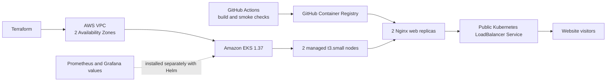

# Nexvion

Nexvion is a static e-commerce storefront used to demonstrate containerization and Kubernetes operations.

**Live demo:** [Open Nexvion](http://a3f2e29baa582462db16f04f84be1408-1948893176.ap-south-1.elb.amazonaws.com/)

The demo is served over HTTP through an AWS load balancer. It has no custom domain or TLS certificate.

## Architecture



## Stack

- **Frontend:** HTML, CSS, and JavaScript
- **Container:** Docker and Nginx on port 8080, with `/healthz`
- **CI:** GitHub Actions validates files, builds the image, runs smoke checks, and publishes to GHCR
- **Cloud:** Terraform creates a VPC, NAT Gateway, EKS control plane, and managed worker nodes in `ap-south-1`
- **Kubernetes:** two web replicas, health probes, resource limits, disruption budget, and a public Service
- **Monitoring:** Prometheus and Grafana configuration in `monitoring/monitoring-values.yaml`

CI publishes images; deployment to a cluster is a separate step. The new-account infrastructure and deployment instructions are in [the Terraform environment guide](terraform/environments/new-account/README.md).

## Run locally

```sh
docker build -t nexvion .
docker run --rm -p 8080:8080 nexvion
```

Then open `http://localhost:8080`.

## Demo limitations

Authentication and checkout are frontend simulations. Account information and passwords are stored in browser `localStorage`; no real payment is processed. Do not enter real passwords, payment information, or personal details.

## AWS costs

The live EKS environment is intended to stay running, which incurs ongoing charges for the control plane, worker nodes, NAT Gateway, load balancer, storage, public IPv4 addresses, and data transfer. The Terraform guide describes the planned resources; review the AWS bill and configure billing alerts.
